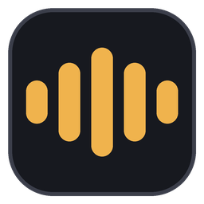
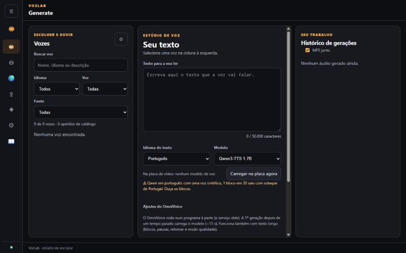
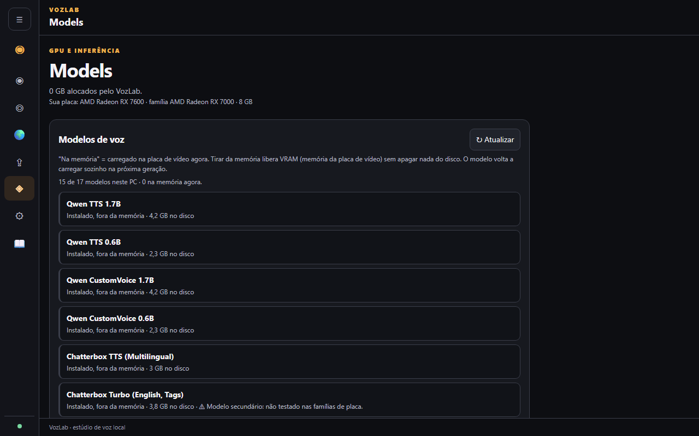

  

<h1 align="center">VozLab</h1>

<h3 align="center">🇧🇷 Voz Local — Para as GPUs do Brasil.</h3>

  <strong>Vozes de IA de alta qualidade na placa de vídeo que você já tem.</strong> 
  Gratuito, local e em português. Um "mod" do <a href="https://github.com/jamiepine/voicebox">Voicebox</a> + <a href="https://github.com/k2-fsa/OmniVoice">OmniVoice</a>,
  ajustado placa por placa para PCs comuns.

  
  
  
  
  

  <!-- Capturas da interface (servidor de teste, sem vozes importadas). Trocar por capturas com a biblioteca antes de publicar. -->
  
    
  

> [!CAUTION]
> ### ⛔ Este programa NÃO foi feito para rodar no processador (CPU)!
> **Se você não tem uma placa de vídeo compatível, NÃO USE.** Sem placa, a geração fica extremamente lenta (um bloco pode levar vários minutos) e o PC pode travar.
> O VozLab precisa de uma placa **AMD RX 6000/7000** ou **NVIDIA GTX 1000/RTX 3000**, com 4 a 8 GB. Confira a sua placa na [tabela](#-perfil-por-família-de-placa-de-vídeo) antes de instalar.

---

## Por que o VozLab?
| | |
|---|---|
| 🎮 **Feito para placas modestas** | Roda em placas de **4 a 8 GB**: AMD RX 6000/7000 e NVIDIA GTX 1000/RTX 3000. Ele reconhece a sua placa sozinho e mostra só o que cabe nela, sem tentativa e erro. Cada limite foi **medido**, não chutado. |
| 🎙️ **Qualidade de estúdio** | Os melhores modelos de voz abertos (Qwen3-TTS, Chatterbox, OmniVoice) clonam uma voz com poucos segundos de áudio. No texto longo, o Whisper ouve cada bloco e **refaz sozinho** os que saíram errados. |
| ⚡ **Rápido onde importa** | O OmniVoice gera mais rápido que o tempo real (~2,5× numa RX 7600) e já fica "aquecido" ao carregar. O Kokoro passa de 10×. Textos longos rodam em blocos e **retomam de onde pararam** se o PC desligar. |
| 🧊 **Sem congelar o Windows** | O trabalho pesado fica na placa de vídeo, não no processador. Um modelo usa a placa por vez (o VozLab e o OmniVoice se revezam sozinhos, sem cortar nenhuma geração). E se o programa fechar de repente, o servidor se desliga sozinho e devolve a placa. |
| 🔒 **100% no seu PC** | Sem mensalidade e sem mandar o seu texto para a internet. |

## O que é o VozLab?
O VozLab transforma texto em voz **no seu próprio computador**, sem mensalidade e sem mandar o seu texto para a internet. Ele clona uma voz a partir de alguns segundos de áudio, lê textos longos (capítulos, roteiros de vídeo) em blocos e junta tudo num áudio só.

Ele junta dois projetos de código aberto:
- **Voicebox**, a base do estúdio, com vários motores de voz;
- **OmniVoice**, um modelo multilíngue que roda num programa à parte e conversa com o VozLab.

Por cima disso vêm uma interface nova em português e otimizações para as placas de vídeo mais comuns no Brasil.

## Download
> 🚧 Em preparação. Por enquanto, siga a [instalação](INSTALAR.md).

## Recursos
### 🎙️ Vários motores de voz
Qwen3-TTS (1.7B e 0.6B), Qwen Custom Voice, Chatterbox, Chatterbox Turbo, OmniVoice, F5-TTS, Kokoro e LuxTTS, todos escolhidos na mesma tela. Veja as licenças em [MODELOS.md](MODELOS.md).

### 📚 Texto longo de verdade
- Divide o texto em blocos e gera um por um.
- Junta os blocos com emendas suaves e volume nivelado.
- Se a luz cair ou você fechar o programa, **retoma de onde parou**.
- Revisão opcional com o Whisper: ele ouve cada bloco e refaz os que saíram errados.

### 🌍 OmniVoice integrado
- Aba própria com clonar, criar voz por descrição e voz automática.
- Um "árbitro" divide a placa de vídeo entre o VozLab e o OmniVoice: um de cada vez, **sem cortar nenhuma geração**.
- O OmniVoice já fica aquecido quando você carrega o modelo.

### 🖥️ Perfil por família de placa de vídeo
O VozLab descobre sozinho a sua placa e mostra **quais modelos cabem nela**:

| Família | Memória | O que roda |
|---|---|---|
| AMD RX 7000 (testada: RX 7600) | 8 GB | todos os 6 modelos principais |
| AMD RX 6000 / NVIDIA RTX 3000 | 6–8 GB | todos; em 6 GB, os modelos 1.7B com aviso |
| AMD RX 6500 XT e outras de 4 GB | 4 GB | Custom Voice 0.6B e OmniVoice (apertado) |
| NVIDIA GTX 1000 | 4 GB | só o OmniVoice (não testado em placa real) |

Detalhes e números medidos: [docs/GUIA_PLACAS.md](docs/GUIA_PLACAS.md).

### 📖 Biblioteca de vozes
Centenas de vozes de referência em vários idiomas, das bases públicas Google FLEURS e Open-Swara. Elas são importadas pela tela "Importar vozes" (pacotes na página de Releases).

### 🎧 MP3 junto
Com o interruptor "MP3 junto" ligado, todo áudio baixado vem em `.wav` **e** em `.mp3`.

### 🔒 Seus dados ficam no seu PC
Vozes, histórico e áudios ficam em `%APPDATA%\sh.voicebox.app`. Nada é enviado para a internet, a não ser o download dos modelos, feito das páginas oficiais.

## Instalação rápida
1. Veja se a sua placa está na tabela acima.
2. Siga o [INSTALAR.md](INSTALAR.md): ele instala o PyTorch certo para a sua família de placa, com as versões fixas.
3. Abra o `VozLab.exe`. Na primeira geração, o modelo escolhido é baixado.

## Documentação
- [INSTALAR.md](INSTALAR.md): instalação por família de placa
- [docs/GUIA_PLACAS.md](docs/GUIA_PLACAS.md): o que cada placa roda e o que esperar
- [docs/GUIA_AJUSTES.md](docs/GUIA_AJUSTES.md): drivers, Windows e dicas para ficar mais rápido
- [docs/GUIA_PARA_IA.md](docs/GUIA_PARA_IA.md): como pedir ajuda a uma IA sem perder as suas vozes
- [docs/COMO_USAR_TEXTO_LONGO.md](docs/COMO_USAR_TEXTO_LONGO.md): o texto longo passo a passo
- Dentro do programa: aba **Guia**

## Créditos e licença
- Código do VozLab: **MIT** ([LICENSE](LICENSE)), baseado no Voicebox (MIT).
- `OmniVoice/`: **Apache-2.0** ([OmniVoice/LICENSE](OmniVoice/LICENSE)).
- Modelos: licenças próprias. **OmniVoice e F5-TTS são "não comercial"**: veja [MODELOS.md](MODELOS.md).
- Agradecimentos completos: [CREDITOS.md](CREDITOS.md).

Feito no Brasil, de graça, para quem cria conteúdo. 💚

